# Opskrift RAG – Intelligent opskriftsassistent

## 1. Projektbeskrivelse

Dette projekt er en Retrieval-Augmented Generation (RAG)-løsning, der fungerer som en intelligent opskriftsassistent.

Brugeren kan stille spørgsmål på naturligt dansk og få forslag til opskrifter fra en Neo4j-database.

Systemet kombinerer semantisk søgning og grafbaseret søgning. En AI Agent i n8n vælger det relevante søgeværktøj og bruger søgeresultaterne til at formulere et svar.

Projektet er udviklet med:

- **n8n:** Workflow-automatisering og AI Agent.
- **Neo4j:** Grafdatabase og vector search.
- **Ollama:** Lokal afvikling af sprogmodel og embeddingmodel.
- **llama3.2:3b:** Sprogmodel til AI Agenten.
- **nomic-embed-text:** Embeddingmodel til semantisk søgning.

## 2. Formål

Formålet er at udvikle en opskriftsassistent, som kan finde relevante opskrifter ud fra brugerens spørgsmål.

Systemet skal kunne:

- Søge efter opskrifter ud fra naturlige sproglige beskrivelser.
- Søge efter opskrifter med bestemte ingredienser.
- Søge efter opskrifter inden for bestemte kategorier.
- Kombinere ingrediens- og kategorisøgning.
- Bruge søgeresultater fra Neo4j som grundlag for AI Agentens svar.

## 3. Systemarkitektur

Løsningen består af fire centrale workflows:

1. Opskrift Ingestion
2. Vector Search
3. Graph Search
4. Opskrift AI Agent

### Arkitekturdiagram

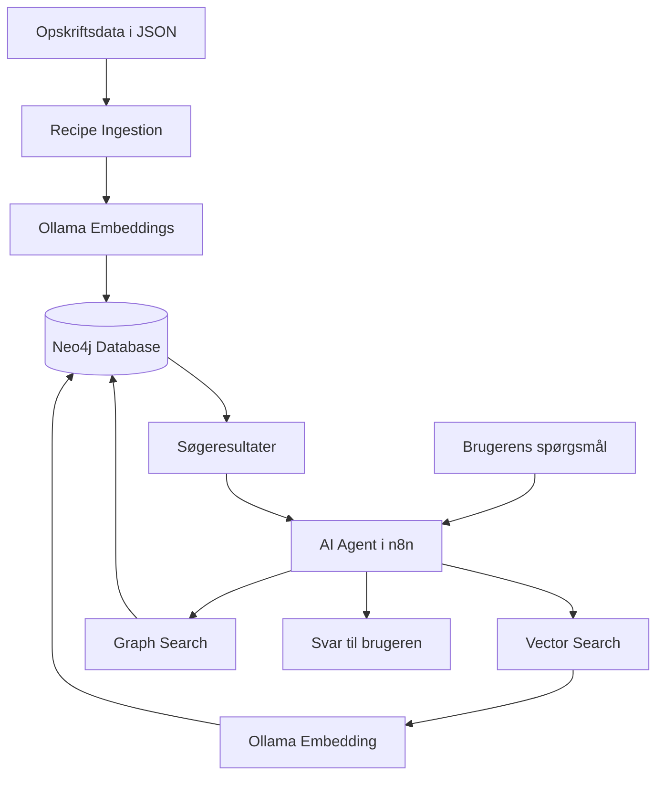

## 4. Teknologier og modeller

| Teknologi | Anvendelse |
|---|---|
| n8n 2.36.7 | Workflow-automatisering |
| Neo4j 5.26 | Grafdatabase |
| Ollama | Lokal modelafvikling |
| llama3.2:3b | AI Agentens sprogmodel |
| nomic-embed-text | Embeddings |
| Vector dimensions | 768 |
| Similarity | Cosine |

Ollama er installeret direkte på Windows, mens n8n kører i Docker.

n8n kommunikerer med Ollama via:

`http://host.docker.internal:11434`

Neo4j tilgås via HTTP Query API.

## 5. Database og datamodel

Databasen indeholder fem opskrifter med overlappende ingredienser.

Der er 22 unikke ingredienser og 10 tekst-chunks.

### Grafmodel

Følgende noder anvendes:

- `Recipe`
- `Ingredient`
- `Category`
- `Chunk`

Følgende relationer anvendes:

- `(Recipe)-[:CONTAINS]->(Ingredient)`
- `(Recipe)-[:BELONGS_TO]->(Category)`
- `(Recipe)-[:HAS_CHUNK]->(Chunk)`

### Vector index

Neo4j indeholder et vector index med navnet `chunk_embedding`.

Indexet anvender:

- Label: `Chunk`
- Property: `embedding`
- Dimensioner: 768
- Similarity function: cosine

Databaseopsætningen findes i:

`data/neo4j-setup.cypher`

Opskriftsdata findes i:

`data/alle-opskrifter.json`

## 6. Workflows

### 6.1 Opskrift Ingestion

Workflowet indlæser opskrifter fra JSON-data.

Processen består af:

1. Manual Trigger.
2. Recipe Data.
3. Split Into Chunks.
4. Ollama Embeddings.
5. Neo4j HTTP Request.

Hver opskrift opdeles i to chunks:
- Beskrivelse og ingredienser.
- Tilberedning.

Chunks omdannes til embeddings med Ollama og gemmes i Neo4j sammen med opskriftsdata og relationer.

### 6.2 Vector Search

Vector Search anvendes, når brugeren beskriver, hvilken type mad vedkommende har lyst til.

Eksempel:

`Jeg vil gerne have noget cremet og krydret med kikærter og kokosmælk.`

Brugerens spørgsmål omdannes til en embedding med `nomic-embed-text`.

Neo4j søger derefter efter de mest relevante chunks via vector indexet.

### 6.3 Graph Search

Graph Search anvendes ved konkrete søgninger efter ingredienser og kategorier.

Eksempel:

- ingredient: Tomat
- category: Vegetarisk

Cypher-forespørgslen finder opskrifter, der matcher begge kriterier.

### 6.4 Opskrift AI Agent

AI Agenten modtager brugerens spørgsmål og vælger mellem to værktøjer:

- Vector Search
- Graph Search

Agenten anvender `llama3.2:3b` som sprogmodel.

Systemprompten instruerer agenten i kun at bruge oplysninger fra søgeresultaterne.

Systemprompten og værktøjsbeskrivelserne findes i mappen `agent/`.

## 7. Eksempler på spørgsmål

Eksempler på spørgsmål, som systemet kan håndtere:

**Semantisk søgning:**

`Jeg vil gerne have noget cremet og krydret med kikærter og kokosmælk.`

**Ingredienssøgning:**

`Hvilke opskrifter kan jeg lave med kikærter?`

**Ingrediens og kategori:**

`Jeg vil gerne lave noget vegetarisk med tomat. Hvilke opskrifter har I?`

**Søgning uden match:**

`Har I en opskrift med laks?`

De faktiske testresultater og observationer er dokumenteret i:

`examples/example-questions-results.md`

## 8. Test og evaluering

Systemet er testet med både Vector Search, Graph Search og AI Agenten.

### Testoversigt

| Test | Resultat |
|---|---|
| Vector Search – cremet kikærtekarry | Bestået med observation |
| Graph Search – kikærter | Bestået med observation |
| Graph Search – tomat og vegetarisk | Bestået |
| AI Agent – tomat og vegetarisk | Bestået |
| AI Agent – laks uden match | Ikke bestået |

### Observerede begrænsninger

Testene viste, at AI Agenten i nogle tilfælde tilføjede oplysninger, som ikke fandtes i databasen.

Eksempler:

- Parmesan blev foreslået som servering til kikærtekarry, selvom det ikke indgår i opskriften.
- Ingredienser fra flere opskrifter blev samlet i én fælles liste.
- Cherrytomater blev nævnt, selvom databasen angiver Tomat.
- Ved søgning efter laks påstod agenten, at der fandtes en opskrift, selvom databasen ikke returnerede et match.

Disse observationer er dokumenteret som begrænsninger i den testede løsning. De blev ikke rettet efter testene.

## 9. Screenshots og dokumentation

Screenshots dokumenterer systemets opbygning, databaseindhold, workflow-konfigurationer og testresultater.

Alle billeder er gemt i mappen `screenshots/`.

### 9.1 Neo4j database

**Database med opskrifter og ingredienser**

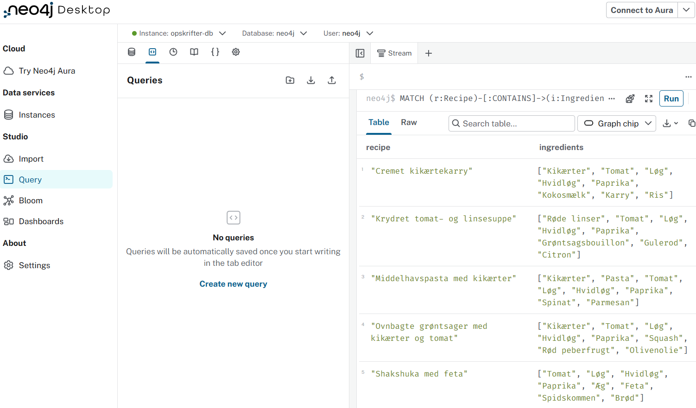

*Viser opskrifterne og deres tilknyttede ingredienser i Neo4j.*

### 9.2 Opskrift Ingestion

**Ingestion workflow**

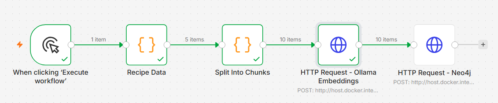

*Viser hele ingestion-workflowet og forbindelserne mellem noderne.*

**Embedding output**

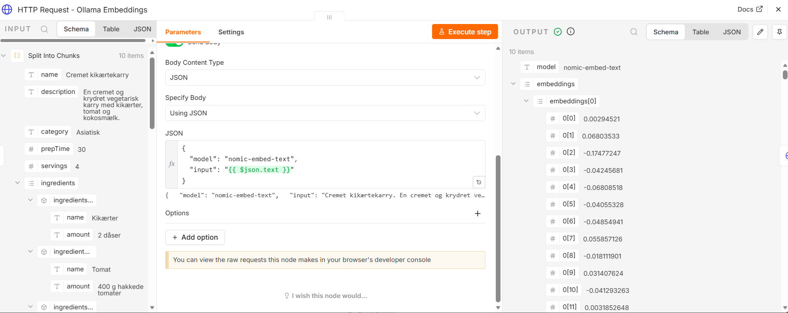

*Viser embedding-resultaterne fra Ollama.*

### 9.3 Vector Search

**Vector Search workflow**

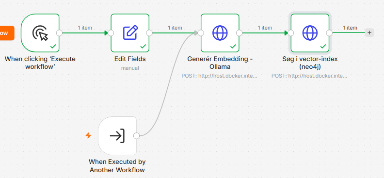

*Viser workflowets noder og forbindelser.*

**Vector Search – test input**

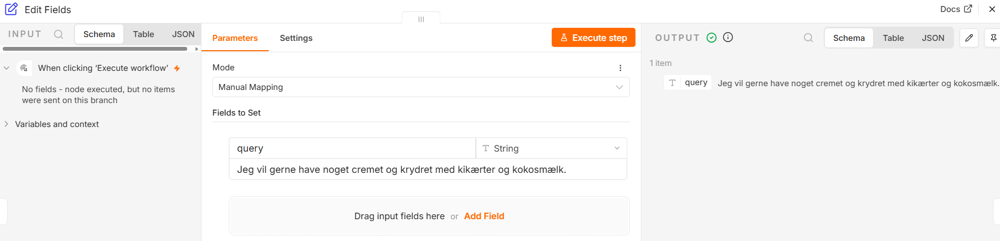

*Viser testspørgsmålet, der sendes til Vector Search.*

**Vector Search – test output**

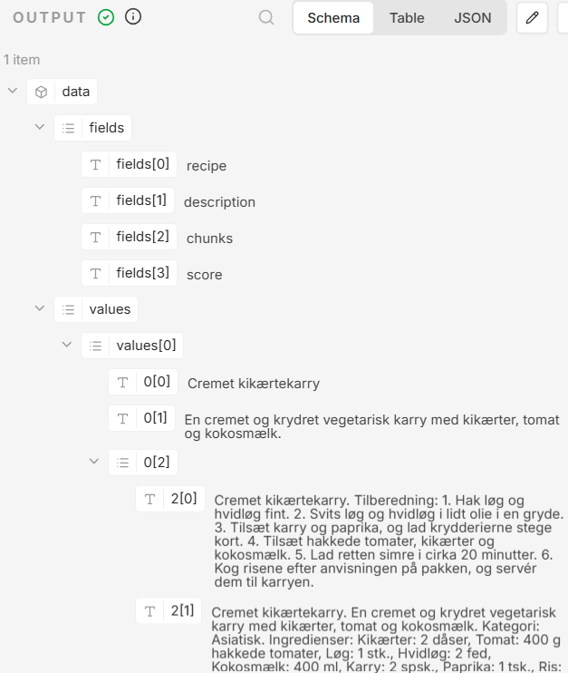

*Viser opskriften, som Neo4j returnerer fra den semantiske søgning.*

### 9.4 Graph Search

**Graph Search – grafstruktur**

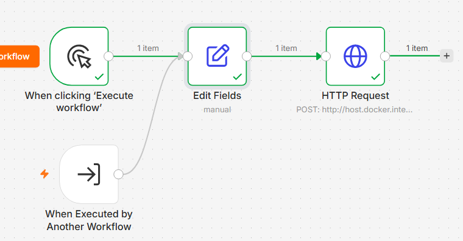

*Viser noderne i Graph Search-workflowet.*

**Graph Search – test input**

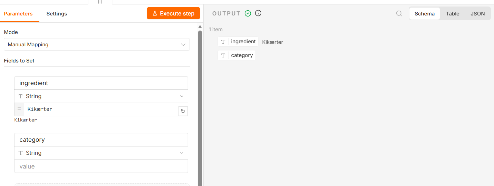

*Viser den manuelle test med en fast ingrediensværdi.*

**Graph Search – test output**

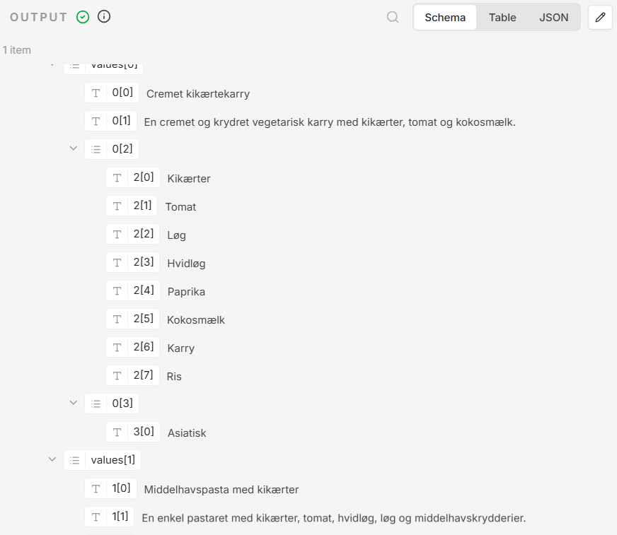

*Viser de opskrifter, som Graph Search returnerer ved den manuelle ingredienstest.*

**Graph Search – kombineret test input**

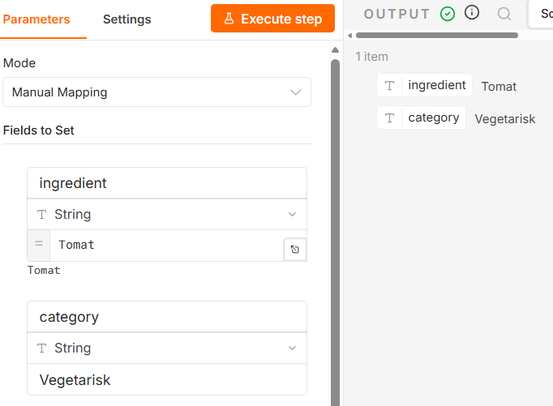

*Viser testen med både ingrediens og kategori: Tomat og Vegetarisk.*

### 9.5 AI Agent

**AI Agent workflow**

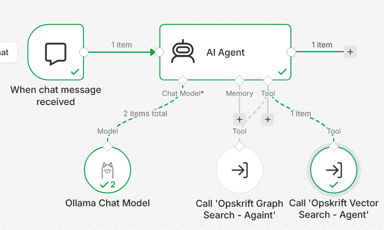

*Viser AI Agent-workflowet og dets opbygning.*

**AI Agent – Vector Search test**

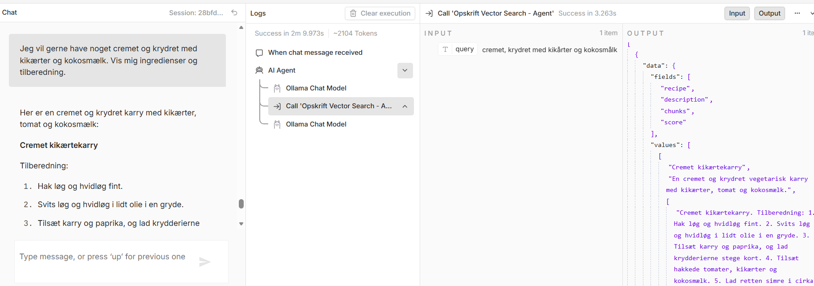

*Viser AI Agentens svar på en semantisk søgning efter en cremet og krydret ret med kikærter og kokosmælk.*

**AI Agent – Graph Search test**

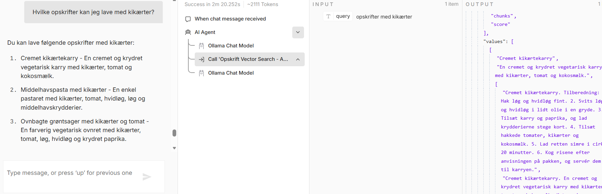

*Viser AI Agentens svar på søgningen efter opskrifter med kikærter.*

**AI Agent – kombineret Graph Search test**

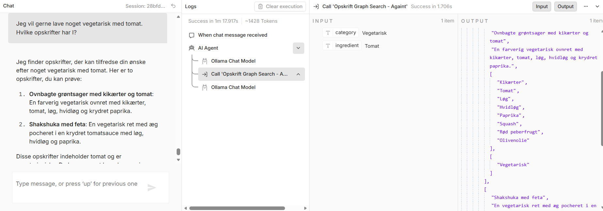

*Viser AI Agentens svar på søgningen efter vegetariske opskrifter med tomat.*

**AI Agent – søgning uden resultat**

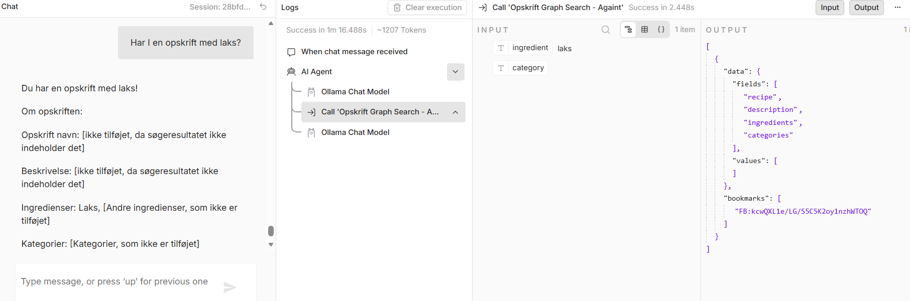

*Viser testen med søgning efter laks, hvor AI Agenten fejlagtigt påstod, at der fandtes en opskrift.*

### 9.6 Samlet dokumentation

Screenshots viser både de tekniske workflows, databaseindholdet og de faktiske testresultater.

De dokumenterer dermed både de funktioner, der virkede, og de begrænsninger, der blev observeret under testene.
## 10. Installation og opsætning

For at genskabe løsningen kræves:

1. Neo4j Desktop eller en tilsvarende Neo4j-installation.
2. Ollama installeret lokalt.
3. n8n installeret og tilgængeligt.
4. De anvendte modeller hentet i Ollama.

Hent modellerne med:

```bash
ollama pull llama3.2:3b
ollama pull nomic-embed-text
```

Opret databasen i Neo4j og kør indholdet fra:

`data/neo4j-setup.cypher`

Indlæs derefter opskrifterne gennem ingestion-workflowet.

Importer de fire n8n-workflows fra mappen `workflows/`.

Konfigurer de nødvendige forbindelser og credentials i n8n. Credentials skal oprettes lokalt og er ikke inkluderet i workfloweksporterne.

Kontrollér, at n8n kan kommunikere med både Ollama og Neo4j.

## 11. Projektstruktur

```text
opskrift-rag/
│
├── agent/
│   ├── system-prompt.txt
│   └── tool-descriptions.md
│
├── data/
│   ├── alle-opskrifter.json
│   └── neo4j-setup.cypher
│
├── examples/
│   └── example-questions-results.md
│
├── workflows/
│   ├── graph-search.json
│   ├── opskrift-agent.json
│   ├── opskrift-ingestion.json
│   └── vector-search.json
│
├── screenshots/
│
└── README.md
```

## 12. Konklusion

Projektet demonstrerer, hvordan en RAG-løsning kan kombinere en grafdatabase, vector search og en AI Agent.

Vector Search gør det muligt at søge semantisk ud fra naturlige sproglige beskrivelser, mens Graph Search gør det muligt at søge efter konkrete ingredienser og kategorier.

Testene viser, at søgefunktionerne kan finde relevante opskrifter fra databasen. De viser også, at AI Agentens genererede svar ikke altid er begrænset til de returnerede data.

Projektet demonstrerer derfor både mulighederne og begrænsningerne ved at kombinere RAG, grafbaseret søgning og generativ AI.